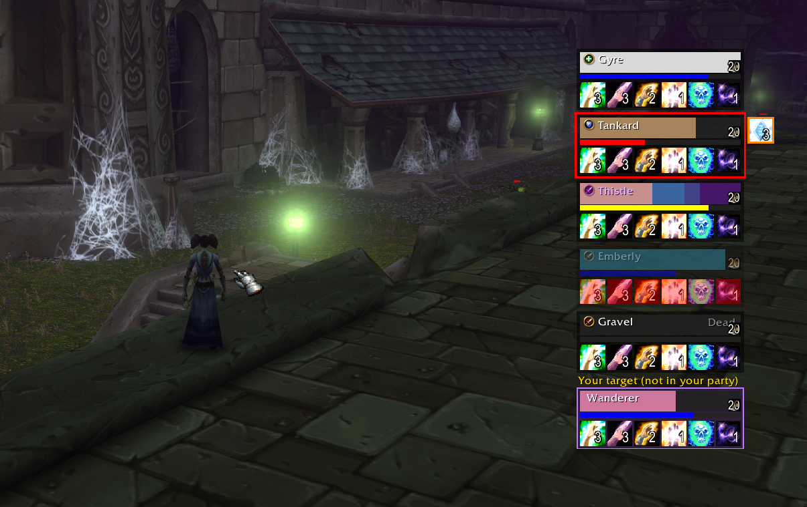

# Opcow's Click Cast

A World of Warcraft: Forever addon for click casting. It shows a party frame with a row of spell and macro buttons under each member. Clicking a button casts that spell or macro on that member, in combat too.

## Buttons

Open the options window with `/occ`, the minimap button or the addon compartment. Add a spell from your spellbook, add a macro, or drag either onto the list.

- **Left click** casts the spell at the rank you picked. **Highest** follows new ranks as you learn them. Click a spell in the list to pick its rank.
- **Shift-click** has its own action, set on the Shift-click tab. **Auto** casts the same spell a rank lower. With Shift held, the buttons show what Shift-click will cast.
- **Right-click** casts a rank lower, or a rank higher if you set it to. **Shift-right: 2 ranks lower** is an option.
- **Macros** work as buttons. Write `@unit` where the target goes, ex: `/cast [@unit] Renew`, and it becomes the member you clicked.
- **Self only** buttons cast on you and show on your own frame only, ex: racials.
- **Remind** (spells only) marks a buff to keep up. Out of combat, a member missing that buff gets its icon beside their frame, and the button glows. Pick the glow (Pulse, Flash, Steady, Spell alert or None) with **Reminder glow** in the options. A buff from anyone counts, and so do the group versions, ex: Prayer of Fortitude for Power Word: Fortitude. Party buffs can't be read in combat, so reminders hide during a fight. Members who are dead, offline or out of sight are skipped.
- **Reminder only** (with Remind) takes the button out of the row under each member. It shows beside a member's frame only while they're missing the buff, in place of the icon, and you click it there to cast. Good for buffs you cast now and then.
- **Never downrank** makes a button always cast its own rank, on every click.
- **Classes** shows a button only under members of the classes you pick, ex: Arcane Intellect under mana users.

Each button shows the spell's cooldown. It also shows a swipe while your own buff or HoT from that spell is on the member, ex: Renew. A button turns red while the member has a debuff that stops you casting its spell on them, ex: Weakened Soul for Power Word: Shield, with a swipe showing when it wears off. A dispel spell's button (Dispel Magic, Cure Disease, Remove Curse, Cure Poison, Purify, Cleanse) gets a highlight in the debuff's colour while the member has a debuff it can remove, in combat too. Pick its look: Border, Thick border, Glow, Tint, Corner or Spell alert.

## The frame

Each member shows health, power, incoming heals, your buffs, dispellable debuff colours, threat, role icon and range. A member out of range has faded bars and red buttons. Class colours are optional. Click the bars to target the member.

When you target a friendly player who isn't in your party, a target frame shows under the party with the same buttons. It has a purple outline, so it can't be mistaken for a party member.

The options window sets the button size, buttons per row, frame width, bar height, scale, bar texture and sort order (group, role or name). It can also show your frame when you're not in a group, and hide Blizzard's party frames. Unlock the frame to drag it. **Preview** shows made up party members, so you can see the layout while solo.

## Button sets

Save your buttons as a set and load it on any of your characters of the same class. Right-click the minimap button for a quick set menu.

## Slash commands

`/occ help` lists them. Every option is also in the options window.
